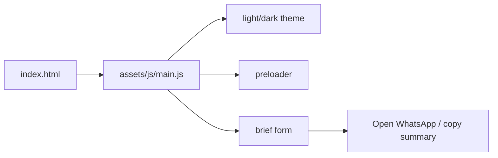

# tessumax-landing

**English** · [Português (Brasil)](README.md)

[](#) [](#) [](#) [](#)

## What it is

The landing page of **Tessumax**, Kelvin Oliveira's digital-services brand: development of **websites, systems, apps, video and marketing** — "from brief to launch". The page presents four service lines, a step-by-step process, published verifiable products, testimonials, an FAQ and a **brief form** that builds a project summary to send via WhatsApp.

## Status

In production. Published at <https://kelvinoliveiracode.github.io/tessumax-landing/> (HTTP 200 verified).

## Features

- **Four service lines**: websites, systems, apps, video and marketing.
- **Process section**: clear steps, "no surprises".
- **Published products and niche templates** as proof of work.
- **Mastered technologies** (stack/logos list).
- **Testimonials** and **FAQ** (direct questions).
- **Brief form**: collects name, e-mail/WhatsApp and scope; generates a summary with **WhatsApp** or **copy summary** options (no backend).
- **Light/dark theme** persisted in `localStorage` (`tessumax-theme`), respecting `prefers-reduced-motion`.
- **Locally served fonts** (Archivo + JetBrains Mono, see `assets/SOURCES.txt`).

> Note: the previous README described a **cloud-services catalog** — it does not exist in this repository. Corrected.

## Architecture

A static single-page landing: `index.html` (1,184 lines) + `assets/js/main.js` (830 lines, vanilla) + `assets/css/main.css` (1,779 lines). Interactivity: light/dark theme, preloader, brief validation/generation and WhatsApp opening. No framework, no build, no backend.



## Stack

- HTML5, CSS3, vanilla ES6+ JavaScript
- Local fonts: Archivo + JetBrains Mono (see `SOURCES.txt`)
- Hosting: GitHub Pages

## Repository layout

```
tessumax-landing/
├── index.html              # the whole landing (1,184 lines)
├── assets/
│   ├── css/main.css        # theme and layout (1,779 lines)
│   ├── js/main.js          # logic (830 lines)
│   ├── fonts/              # Archivo + JetBrains Mono (local)
│   └── SOURCES.txt         # asset origins
└── .nojekyll               # GitHub Pages deploy without Jekyll
```

## Prerequisites and installation

None. Just serve the folder statically.

## How to run

```bash
python -m http.server 8080
# then visit http://localhost:8080
```

## Tests and quality

There are no automated tests, `package.json` or CI in this repository (absence confirmed). Validation is manual: the brief form checks e-mail/WhatsApp and scope before building the summary.

## Technical decisions and trade-offs

- **WhatsApp as the lead channel** instead of a backend/e-mail server: no infrastructure cost and straight to conversation; in exchange, no lead is recorded in its own system.
- **Fonts and assets served locally**: performance and CDN independence.
- **Zero framework**: a light landing, easy to maintain and publish on any static host.
- **Theme respecting `prefers-reduced-motion`** and `prefers-color-scheme`.

## Known limitations and roadmap

- The form does not send the lead to a CRM/e-mail; it depends on manual sending via WhatsApp.
- No built-in analytics (the landing does not track visits).
- Static content: updating offers/process requires editing the HTML.

## Development process

An individual project by Kelvin Oliveira, built with orchestrated AI agents and reviewed by the author. The landing architecture, the brief flow and the review are the author's.

## License and author

This repository has **no license file** (no `LICENSE`). Copyright (c) 2026 Kelvin Rebelo de Oliveira — contact the author for use beyond the portfolio.

**Author**: [Kelvin Oliveira](https://github.com/KelvinOliveiraCode) · [Portfolio](https://kelvinoliveiracode.github.io/portfolio/)
