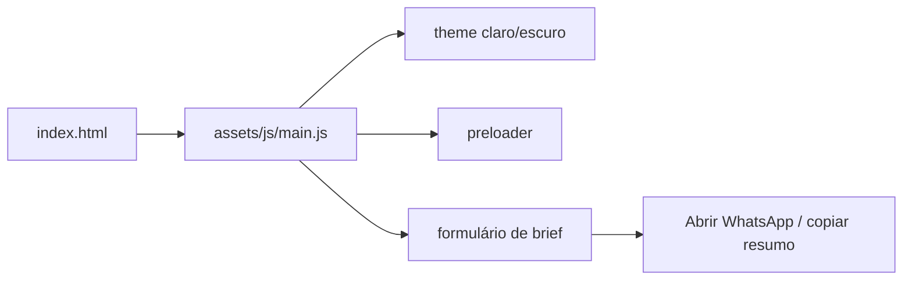

# tessumax-landing

[English](README.en.md) · **Português (Brasil)**

[](#) [](#) [](#) [](#)

## O que é

Landing page da **Tessumax**, a marca de serviços digitais de Kelvin Oliveira: desenvolvimento de **sites, sistemas, apps, vídeo e marketing** — "do brief ao lançamento". A página apresenta quatro frentes de serviço, um processo em etapas, produtos publicados verificáveis, depoimentos, FAQ e um **formulário de brief** que monta um resumo do projeto para enviar pelo WhatsApp.

## Status

Em produção. Publicada em <https://kelvinoliveiracode.github.io/tessumax-landing/> (HTTP 200 verificado).

## Funcionalidades

- **Quatro frentes de serviço**: sites, sistemas, apps, vídeo e marketing.
- **Seção de processo**: etapas claras, "sem surpresa".
- **Produtos publicados e modelos por nicho** como prova de trabalho.
- **Tecnologias dominadas** (lista de logos/stacks).
- **Depoimentos** e **FAQ** (perguntas diretas).
- **Formulário de brief**: coleta nome, e-mail/WhatsApp e escopo; gera um resumo com opção de **abrir o WhatsApp** ou **copiar o resumo** (sem backend).
- **Tema claro/escuro** persistido em `localStorage` (`tessumax-theme`), com respeito a `prefers-reduced-motion`.
- **Fontes servidas localmente** (Archivo + JetBrains Mono, ver `assets/SOURCES.txt`).

> Nota: o README anterior descrevia um **catálogo de serviços de nuvem** — não existe neste repositório. Corrigido.

## Arquitetura

Landing estática de página única: `index.html` (1.184 linhas) + `assets/js/main.js` (830 linhas, vanilla) + `assets/css/main.css` (1.779 linhas). Interatividade: tema claro/escuro, preloader, validação/geração do brief e abertura do WhatsApp. Sem framework, sem build, sem backend.



## Stack

- HTML5, CSS3, JavaScript ES6+ vanilla
- Fontes locais: Archivo + JetBrains Mono (see `SOURCES.txt`)
- Hospedagem: GitHub Pages

## Estrutura do repositório

```
tessumax-landing/
├── index.html              # a landing inteira (1.184 linhas)
├── assets/
│   ├── css/main.css        # tema e layout (1.779 linhas)
│   ├── js/main.js          # lógica (830 linhas)
│   ├── fonts/              # Archivo + JetBrains Mono (locais)
│   └── SOURCES.txt         # origem dos assets
└── .nojekyll               # deploy GitHub Pages sem Jekyll
```

## Pré-requisitos e instalação

Nenhum. Basta servir a pasta estaticamente.

## Como executar

```bash
python -m http.server 8080
# acesse http://localhost:8080
```

## Testes e qualidade

Não há testes automatizados, `package.json` nem CI neste repositório (ausência confirmada). A validação é manual: o formulário de brief checa e-mail/WhatsApp e escopo antes de montar o resumo.

## Decisões técnicas e trade-offs

- **Base de captação via WhatsApp** em vez de backend/email server: sem custo de infraestrutura e direto na conversa; em troca, nenhum lead fica registrado em sistema próprio.
- **Fontes e imagens servidas localmente**: desempenho e independência de CDN.
- **Zero framework**: landing leve, fácil de manter e publicar em qualquer hospedagem estática.
- **Tema com respeito a `prefers-reduced-motion`** e `prefers-color-scheme`.

## Limitações conhecidas e roadmap

- O formulário não envia a lead para um CRM/e-mail; depende do envio manual via WhatsApp.
- Sem analytics próprio (a landing não rastreia visitas).
- Conteúdo estático: atualizar ofertas/processo exige editar o HTML.

## Processo de desenvolvimento

Projeto individual de Kelvin Oliveira, construído com agentes de IA orquestrados e revisado pelo autor. A arquitetura da landing, o fluxo do brief e a revisão são do autor.

## Licença e autor

Este repositório **não possui arquivo de licença** (sem `LICENSE`). Copyright (c) 2026 Kelvin Rebelo de Oliveira — entre em contato com o autor para uso além do portfólio.

**Autor**: [Kelvin Oliveira](https://github.com/KelvinOliveiraCode) · [Portfólio](https://kelvinoliveiracode.github.io/portfolio/)
